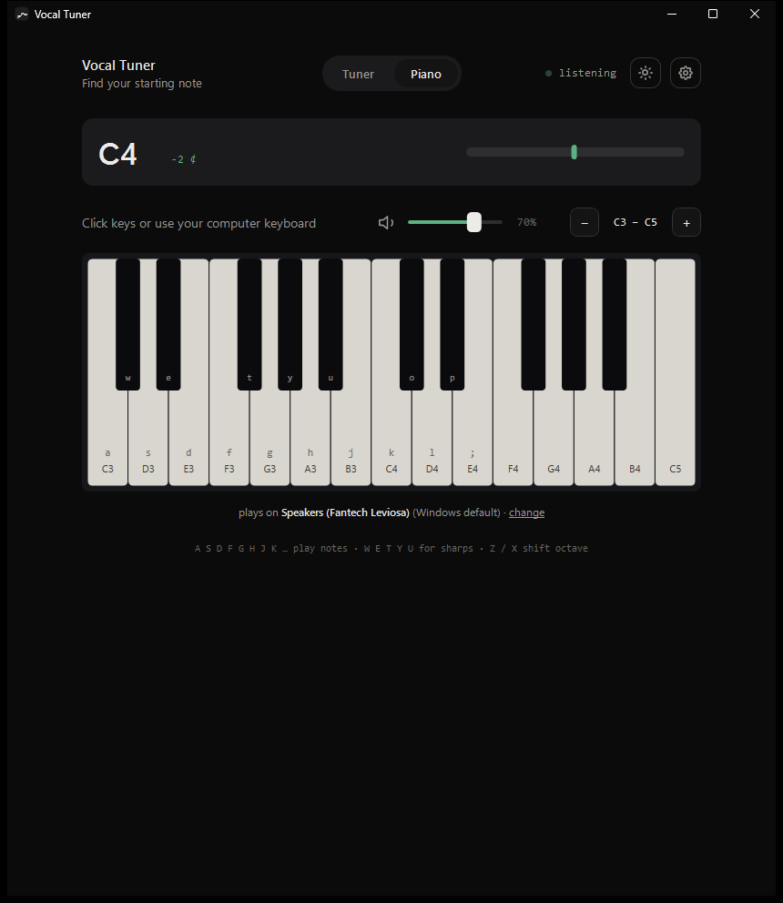
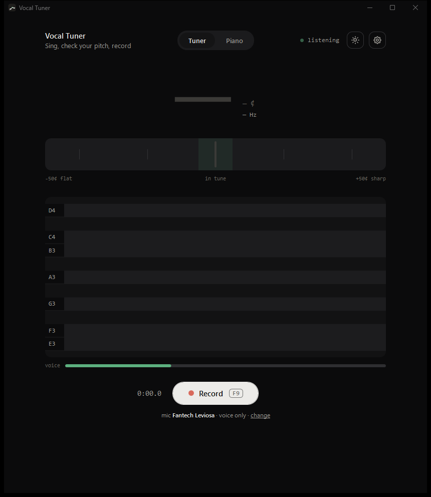
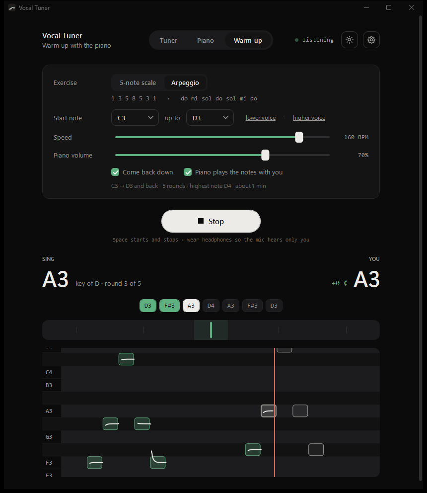
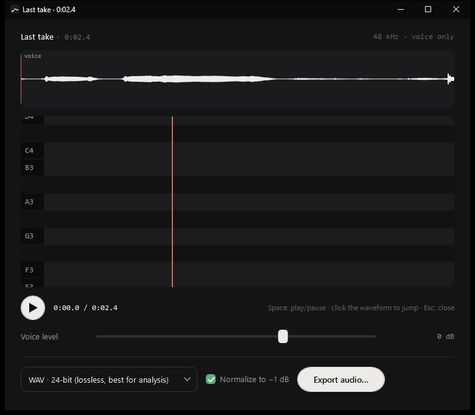
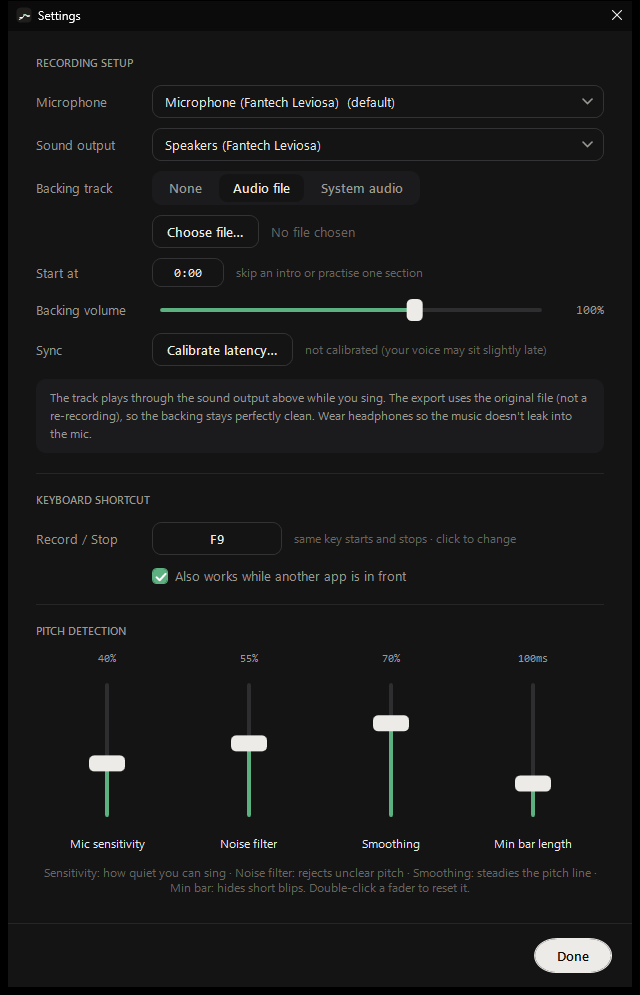

# Vocal Tuner

[](https://github.com/cphudit/vocal-tuner/actions/workflows/build.yml)

A fast, native Windows app for singers: see your pitch live, record yourself over a karaoke or backing track, and export a clean, high-quality audio file.

<p align="center">
  
  
</p>

## Features

- **Live tuner**: note name, cents and Hz, plus a scrolling pitch graph with colour-coded note bars (green ≤ 5¢, amber ≤ 15¢, red beyond). Starts listening as soon as the app opens.
- **Record over a backing track**
  - *Audio file*: an MP3/WAV/M4A/FLAC plays while you sing. The export mixes in the **original file**, so the music stays perfectly clean.
  - *System audio*: records whatever plays on your output (YouTube, Spotify, a karaoke video…) together with your mic.
  - *None*: voice only.
- **Latency calibration**: measures your mic/headphone round-trip once, then lines your voice up with the music automatically. Fine-tune it by ear in the review window.
- **Review window** after each take: waveform, pitch graph, playback, voice and backing levels, and sync nudge.
- **Export**: WAV 24-bit, WAV 32-bit float or MP3 320 kbps, with optional normalisation to −1 dB and an optional voice-only file.
- **Warm-up mode**: one button runs a guided 5-note scale (1-2-3-4-5-4-3-2-1) or arpeggio (1-3-5-8-5-3-1). The piano gives the starting chord, plays along, and moves up a semitone each round to the note you pick, then optionally back down, at the BPM you set. Each note you sing is graded green, amber or red on a scrolling target graph.
- **Coach: feedback on your singing.** Analyse the last take or any recording (WAV, MP3, M4A, FLAC) without knowing the song. You get:
  - strengths, then the 3–5 most important problems with timestamps, a likely cause and exercises for each
  - a 5–10 minute daily practice plan
  - key numbers: notes within ±20/±35 cents, sharp/flat tendency, accuracy per pitch zone, scoops, wandering notes, falling phrase endings, vibrato rate and width, range used, dynamics, and HNR, CPP, jitter and shimmer
  - the key of your singing, notes that keep falling outside it, and, when there is music, whether the whole vocal is shifted against it
  - graphs, a report in English (or Thai, if you choose it), HTML export, and a history that compares each take with the previous one
- **Piano** to find your starting note, playable with the mouse or the computer keyboard. Every note key and the octave-shift keys can be remapped in Settings.
- **Record/stop shortcut**: one key (F9 by default, configurable) that can work even while another app is in front.
- **Sound output picker**: follow the Windows default or pin a specific device.
- Dark mode by default, with a light theme too.

<p align="center">
  
</p>

<p align="center">
  
  
</p>

## Download

Get the latest **`VocalTuner-win-x64.zip`** from the [Releases page](../../releases/latest), unzip it anywhere and run `VocalTuner.exe`. Nothing to install: .NET is included.

- Windows 10 or 11, 64-bit.
- The app isn't code-signed, so Windows SmartScreen may say *"Windows protected your PC"*. Click **More info → Run anyway**.
- Settings are stored in `%LOCALAPPDATA%\VocalTuner\`.

### Privacy

Vocal Tuner never connects to the internet. It uses your microphone and sound output, and everything it keeps (settings, the last take, past analyses) stays in `%LOCALAPPDATA%\VocalTuner\` on your PC. Recordings and reports are saved only where you choose.

### Verify the download

Releases are built by [GitHub Actions](.github/workflows/release.yml) from the source at the release tag, not on someone's PC. Each release page lists the zip's SHA-256 checksum and a link to the build log.

```powershell
Get-FileHash VocalTuner-win-x64.zip                                       # compare with the SHA-256 on the release page
gh attestation verify VocalTuner-win-x64.zip --repo cphudit/vocal-tuner  # proves GitHub built it from this repository
```

## Build from source

Requires the [.NET 10 SDK](https://dotnet.microsoft.com/download).

```powershell
git clone https://github.com/cphudit/vocal-tuner.git
cd vocal-tuner
dotnet run                                          # debug run
dotnet publish -c Release -o dist\VocalTuner        # self-contained build in dist\VocalTuner
```

## How it works

| Part | File | Notes |
|---|---|---|
| UI | `MainWindow`, `SettingsWindow`, `ReviewWindow`, `Controls.cs`, `Styles.xaml`, `Theme.cs` | WPF with custom-drawn controls (pitch roll, tuner bar, faders, keyboard). No WebView, so it opens in well under a second. |
| Live pitch | `LiveInput.cs`, `PitchAnalyzer.cs` | WASAPI capture → downmix to mono, decimate to ≤ 48 kHz → McLeod Pitch Method (NSDF) with SIMD dot products, about 60 analyses per second. |
| Recording and export | `AudioEngine.cs` | Mic, backing playback and loopback run on separate WASAPI streams. Sync is found by cross-correlation against the system-audio copy or from the calibration, and the export is rendered from the original backing file. MP3 export uses Windows Media Foundation. |
| Piano | `PianoSynth.cs` | Wavetable additive synth with a voice limit and a soft limiter, cheap even on 384 kHz devices. |
| Coach | `Coach/*.cs`, `CoachView`, `CoachWindow` | One module per measurement: pitch tracking and note segmentation, intonation, key, note shape (stability, scoops, endings, vibrato), voice quality and registers, dynamics, and music detection. `Feedback.cs` turns the numbers into advice, and all thresholds are in `CoachConfig.cs`. |
| Shortcut | `Shortcut.cs` | In-app key handling, plus a `RegisterHotKey` global hotkey. |

### Diagnostics

The exe has a few headless test modes that write a report into the given folder:

```text
VocalTuner.exe --selftest <dir>                   pitch accuracy, recording in all modes, preview, export
VocalTuner.exe --pianotest <dir>                  offline piano stress render: CPU time, clipping, clicks
VocalTuner.exe --pianolive <dir> [output name]    plays the piano on a real output and checks it via loopback
VocalTuner.exe --outtest <dir> [output name]      sine through different WASAPI setups
VocalTuner.exe --mictest <file>                   microphone mute/volume and capture levels
VocalTuner.exe --coachtest <dir>                  singing analysis on synthetic audio with known answers
VocalTuner.exe --coach <audio> [--backing <file>] [--lang en|th] [--voice tenor] [--out <dir>] [--compare <old.json> …]
                                                  writes "<name> - report.html" and "<name> - analysis.json"
```

The Coach thresholds can be tuned without rebuilding: put the fields you want to change from `Coach/CoachConfig.cs` into `%LOCALAPPDATA%\VocalTuner\coach-config.json`. Analyses are kept in `%LOCALAPPDATA%\VocalTuner\coach\`.

**Recording for the Coach:** wear headphones so the mic hears only your voice, record dry (no reverb or effects), use WAV at 44.1 or 48 kHz, and keep the mic about 15–20 cm away. Music in the recording makes the results less accurate (there is no vocal separation).

## How I built this

I built Vocal Tuner because I wanted one tool to check my pitch while singing and record myself over karaoke tracks, without juggling a tuner, a recorder and an audio editor.

**My part:** the idea and the requirements, every product decision, and testing on my own setup: a USB mic, USB headphones running at 384 kHz, and a USB speaker. I used the app the way a singer would and reported what felt wrong.

**AI's part:** most of the code was written by an AI coding assistant (Claude by Anthropic), working from my requirements and feedback. It also wrote the diagnostic tools we used to find bugs.

How it got where it is:

1. **Prototype to desktop app.** It started as a browser-based pitch tuner. The first desktop version wrapped that page in WebView2 and took about 3 seconds to open, so I decided to rewrite the UI natively in WPF. It now opens in about 0.6 seconds.
2. **Shaped by actual use.** After using it I asked for these changes: record controls on the tuner screen, listening that starts on its own, dark mode by default, settings in their own pop-up, the take review in a separate window you can close, no "discard take?" prompt, a configurable record/stop hotkey that works from other apps, and a sound output picker.
3. **Bugs found on real hardware.**
   - The live tuner showed nothing on my 384 kHz headphones: the analysis window didn't fit the sample buffer. Audio is now decimated to ≤ 48 kHz first.
   - A recording that came out silent turned out to be a system-wide mic mute, not the app. Separating those two cases needed a dedicated mic test mode.
   - The piano crackled like a shorted mic. The first fix (a cheaper synth and a limiter) wasn't enough, so I asked for the live output itself to be measured. The cause: NAudio passes a `byte[]` disguised as a `float[]`, and `Array.Clear` cleared only a quarter of each buffer, so old audio got mixed back in every 10 ms.

## Credits

- Audio I/O: [NAudio](https://github.com/naudio/NAudio) (MIT).

## License

[MIT](LICENSE)

---

### ภาษาไทย

**Vocal Tuner** แอปสำหรับคนร้องเพลงบน Windows ดูได้ว่าร้องตรงคีย์ไหมแบบเรียลไทม์ อัดเสียงร้องพร้อมเพลงคาราโอเกะ (จากไฟล์เพลงหรือเสียงในเครื่อง) แล้ว export เป็นไฟล์ WAV/MP3 คุณภาพสูง มีเปียโนไว้หาโน้ตเริ่มต้น โหมดวอร์มอัพ และหน้า Coach ที่วิเคราะห์การร้อง (ความตรงของโน้ต การช้อนเสียง ท้ายประโยค vibrato คุณภาพเสียง) แล้วบอกจุดแข็ง จุดที่ควรแก้พร้อมเวลาในเพลง และแบบฝึก โดยไม่ต้องรู้ว่าเป็นเพลงอะไร

ดาวน์โหลดไฟล์ `VocalTuner-win-x64.zip` ได้จากหน้า [Releases](../../releases/latest) แตกไฟล์แล้วเปิด `VocalTuner.exe` ได้เลย ไม่ต้องติดตั้งอะไรเพิ่ม ถ้า Windows ขึ้นหน้า "Windows protected your PC" ให้กด More info แล้วกด Run anyway

แอปไม่เชื่อมต่ออินเทอร์เน็ตเลย ข้อมูลทั้งหมดเก็บอยู่ในเครื่องของคุณ และไฟล์ใน Releases ถูก build โดย GitHub Actions จากโค้ดในหน้านี้ ตรวจสอบได้ด้วยค่า SHA-256 ที่อยู่ในหน้า Release

โปรเจกต์นี้ผมเป็นคนคิดไอเดีย กำหนดฟีเจอร์ ทดสอบกับอุปกรณ์จริง และตัดสินใจทุกอย่าง ส่วนโค้ดส่วนใหญ่เขียนโดย AI (Claude) ตามที่ผมกำหนด รายละเอียดอยู่ในหัวข้อ "How I built this"
